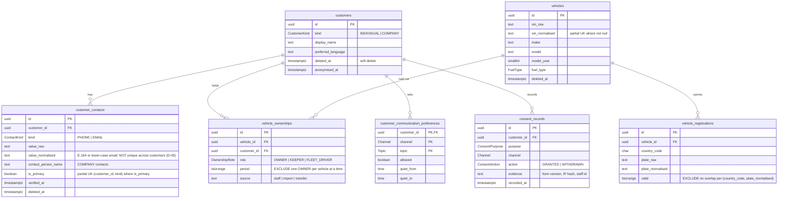
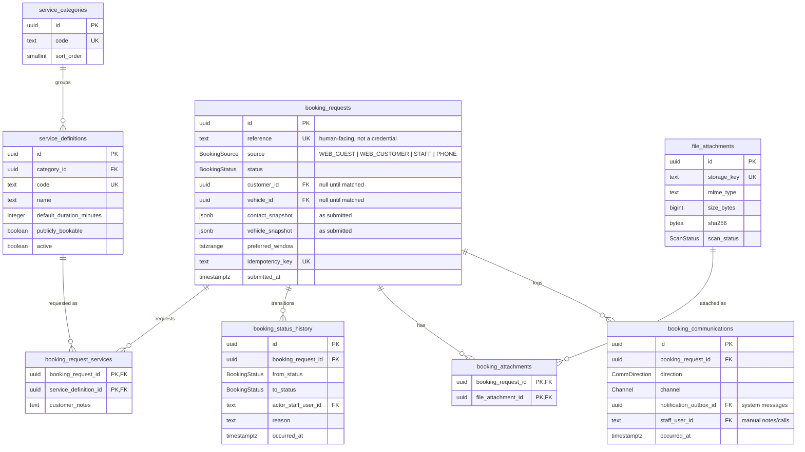
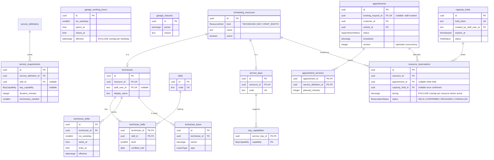
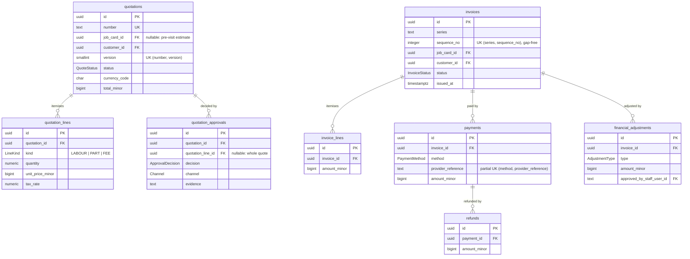
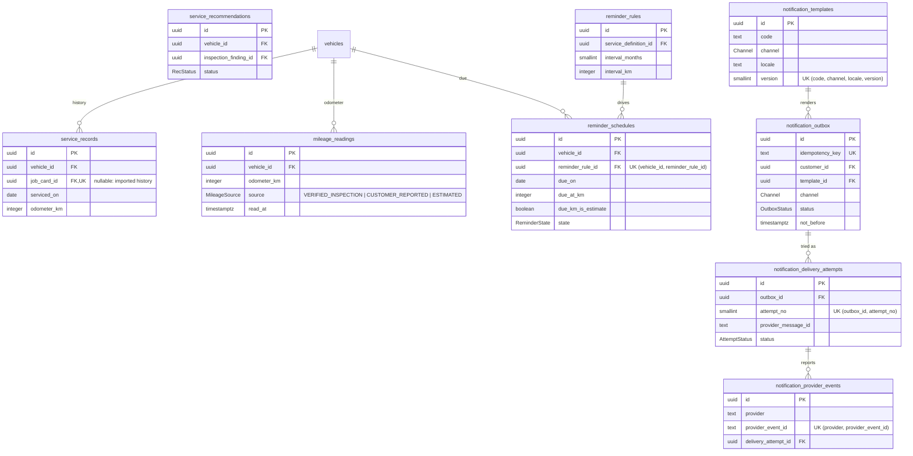
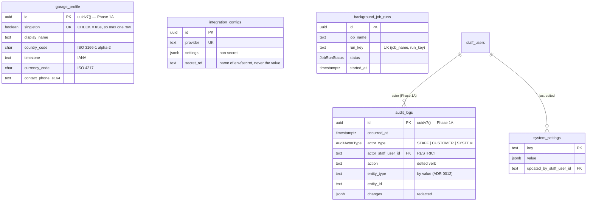

# Entity-relationship design

- **Status:** Phase 1A design baseline (2026-11-24)
- **Format:** Mermaid `erDiagram`, renders on GitHub and can be diffed in Git. One diagram per domain
  plus a context map; attributes show keys and the columns that carry relationships or rules.
- **Legend:** `PK` primary key · `FK` foreign key · `UK` unique (alone or as part of a composite or
  partial unique index) · Mermaid cardinality: `||` exactly one, `o|` zero or one, `}o` zero or
  many, `}|` one or many.
- Tables that exist today: `staff_users` (Phase 0), `garage_profile` and `audit_logs` (Phase 1A).

## 0. Context map

```mermaid
erDiagram
    customers ||--o{ customer_contacts : has
    customers ||--o{ vehicle_ownerships : "owns over time"
    vehicles ||--o{ vehicle_ownerships : "owned over time"
    vehicles ||--o{ vehicle_registrations : "plates over time"
    booking_requests }o--o| customers : "matched to (staff action)"
    booking_requests }o--o| vehicles : "matched to (staff action)"
    booking_requests ||--o| appointments : "confirmed as"
    appointments }o--|| vehicles : for
    appointments }o--|| customers : for
    appointments ||--o{ resource_reservations : allocates
    scheduling_resources ||--o{ resource_reservations : "reserved by"
    appointments ||--o| job_cards : "checked in as"
    job_cards }o--|| vehicles : services
    job_cards }o--|| customers : "billed to"
    job_cards ||--o{ quotations : estimates
    job_cards ||--o{ invoices : bills
    job_cards ||--o| service_records : produces
    service_records }o--|| vehicles : "history of"
    vehicles ||--o{ reminder_schedules : "next due"
    customers ||--o{ consent_records : grants
    notification_outbox }o--o| customers : to
    staff_users ||--o{ audit_logs : "acts in"
```

## A. Identity & access

```mermaid
erDiagram
    staff_users {
        text id PK "cuid (Phase 0)"
        text email UK
        text password_hash
        StaffRole role "legacy enum, superseded by assignments in 1D"
        boolean active
    }
    roles {
        uuid id PK
        text code UK
        boolean system "built-in roles cannot be deleted"
    }
    permissions {
        uuid id PK
        text code UK "e.g. booking.confirm"
    }
    role_permissions {
        uuid role_id PK,FK
        uuid permission_id PK,FK
    }
    staff_role_assignments {
        uuid id PK
        text staff_user_id FK
        uuid role_id FK
        text granted_by_staff_user_id FK
        timestamptz revoked_at "partial UK (staff_user_id, role_id) where revoked_at is null"
    }
    customer_verification_challenges {
        uuid id PK
        uuid contact_id FK "nullable: guest challenge uses target only"
        text target_e164_or_email
        ChallengePurpose purpose
        text code_hash
        timestamptz expires_at
        smallint attempts
        timestamptz consumed_at
    }
    auth_sessions {
        uuid id PK
        SessionSubject subject_type "PORTAL_ACCOUNT | STAFF"
        uuid portal_account_id FK
        text staff_user_id FK
        bytea token_hash UK
        timestamptz expires_at
        timestamptz revoked_at
    }
    auth_events {
        uuid id PK
        AuthEventType type
        text staff_user_id FK
        uuid customer_id FK
        bytea ip_hash
        timestamptz occurred_at
    }
    roles ||--o{ role_permissions : grants
    permissions ||--o{ role_permissions : "granted by"
    staff_users ||--o{ staff_role_assignments : holds
    roles ||--o{ staff_role_assignments : "assigned in"
    staff_users ||--o{ auth_sessions : "signs in (staff, future)"
    staff_users ||--o{ auth_events : generates
    customer_portal_accounts {
        uuid id PK
        ContactKind kind "PHONE | EMAIL"
        text value_normalised UK "E.164 or lower-case email"
        timestamptz verified_at
        timestamptz disabled_at
    }
    customer_portal_access {
        uuid id PK
        uuid portal_account_id FK
        uuid customer_id FK
        PortalRole role "HOLDER | COMPANY_ADMIN | COMPANY_VIEWER"
        text granted_by_staff_user_id FK
        timestamptz revoked_at "partial UK (portal_account_id, customer_id) where revoked_at is null"
    }
    customer_portal_accounts ||--o{ customer_portal_access : "is granted"
    customer_portal_accounts ||--o{ auth_sessions : "signs in (customer)"
```



Customer sessions belong to a **portal account** (a person proving control of a phone/email), not
to a customer. Several customers may share a phone (D-05), so access to each customer requires its
own `customer_portal_access` grant (ADR 0013). The `customers` table is in diagram B.

`auth_sessions` uses an exclusive-arc check: exactly one of `portal_account_id`/`staff_user_id` is set,
matching `subject_type`. Both are real FKs, so this is not polymorphism.

## B. Customer management



## C. Booking management



## D. Smart scheduling



## E. Workshop operations (future)

```mermaid
erDiagram
    job_cards {
        uuid id PK
        text number UK
        uuid appointment_id FK,UK "nullable: walk-in"
        uuid vehicle_id FK
        uuid customer_id FK
        JobStatus status
        integer odometer_in_km
    }
    job_card_tasks {
        uuid id PK
        uuid job_card_id FK
        uuid service_definition_id FK "nullable: ad-hoc"
        uuid assigned_technician_id FK
        TaskStatus status
    }
    vehicle_inspections {
        uuid id PK
        uuid job_card_id FK
        InspectionType type "CHECK_IN | MULTIPOINT | BODYWORK | PRE_DELIVERY"
        integer odometer_km
    }
    inspection_findings {
        uuid id PK
        uuid inspection_id FK
        Severity severity
        uuid recommended_service_definition_id FK
    }
    diagnostic_results {
        uuid id PK
        uuid job_card_task_id FK
        text_array fault_codes
    }
    parts {
        uuid id PK
        text sku UK
    }
    part_requirements {
        uuid id PK
        uuid job_card_task_id FK
        uuid part_id FK
        numeric quantity
        PartReqStatus status
    }
    part_usages {
        uuid id PK
        uuid job_card_task_id FK
        uuid part_id FK
        numeric quantity
        bigint unit_cost_minor
    }
    work_logs {
        uuid id PK
        uuid job_card_task_id FK
        uuid technician_id FK
        tstzrange worked "EXCLUDE overlap per technician"
    }
    job_status_history {
        uuid id PK
        uuid job_card_id FK
        JobStatus to_status
    }
    qc_inspections {
        uuid id PK
        uuid job_card_id FK
        boolean passed
        text inspector_staff_user_id FK
    }
    vehicle_handovers {
        uuid id PK
        uuid job_card_id FK,UK
        integer odometer_out_km
        uuid signature_file_id FK
    }
    paint_production_blocks {
        uuid id PK
        uuid job_card_id FK
        PaintStage stage
        smallint sequence
        PaintBlockStatus status "booth time = its resource_reservations row (kind PRODUCTION)"
    }
    job_cards ||--o{ job_card_tasks : contains
    job_cards ||--o{ vehicle_inspections : "inspected in"
    vehicle_inspections ||--o{ inspection_findings : finds
    job_card_tasks ||--o{ diagnostic_results : records
    job_card_tasks ||--o{ part_requirements : needs
    job_card_tasks ||--o{ part_usages : uses
    parts ||--o{ part_requirements : "required as"
    parts ||--o{ part_usages : "used as"
    job_card_tasks ||--o{ work_logs : "worked in"
    job_cards ||--o{ job_status_history : transitions
    job_cards ||--o{ qc_inspections : "checked in"
    job_cards ||--o| vehicle_handovers : "released in"
    job_cards ||--o{ paint_production_blocks : "painted in"
```



## F. Quotations & finance (future)



## G. Customer retention



## H. Platform administration



## Referential actions

| Relationship                                                                                                       | ON DELETE                                                           | Why                                                                                              |
| ------------------------------------------------------------------------------------------------------------------ | ------------------------------------------------------------------- | ------------------------------------------------------------------------------------------------ |
| `audit_logs.actor_staff_user_id → staff_users`                                                                     | **RESTRICT** (1A)                                                   | Audit evidence must keep its actor; staff are deactivated, not deleted                           |
| Child "detail" rows → aggregate root (contacts → customer, lines → quotation, attempts → outbox, role_permissions) | CASCADE                                                             | Rows have no meaning without the parent and are only hard-deleted with it during approved purges |
| History rows (`*_status_history`, `consent_records`, `mileage_readings`, `vehicle_ownerships`)                     | RESTRICT                                                            | History must not vanish silently                                                                 |
| Cross-aggregate references (appointment → customer/vehicle, job card → appointment, invoice → job card)            | RESTRICT                                                            | Business records are soft-deleted or anonymised, never cascaded                                  |
| Optional links (`booking_requests.customer_id`, `technicians.staff_user_id`)                                       | SET NULL only where losing the link is harmless; otherwise RESTRICT | Documented per table in the data dictionary                                                      |
| All FKs                                                                                                            | ON UPDATE CASCADE (Prisma default; keys are immutable in practice)  | —                                                                                                |

## Indexing strategy

1. **Every FK column gets an index** (PostgreSQL does not create them automatically). A composite
   index whose leading column is the FK counts.
2. **Partial unique indexes** encode "one current/active X": `WHERE deleted_at IS NULL`,
   `WHERE revoked_at IS NULL`, `WHERE is_primary`.
3. **Time-descending composites** for history lists (`(entity, occurred_at DESC)`), as on
   `audit_logs`.
4. **GiST exclusion constraints** (`btree_gist`) on `tstzrange` columns for non-overlap: reservations,
   ownership periods, plate validity, work logs. Paint stages reserve booths through
   `resource_reservations`, so one constraint covers all booth usage.
5. **Trigram indexes** (`pg_trgm`) on normalised names, plates and phones for duplicate detection and
   staff search (1B).
6. **No speculative indexes.** Add them with the query that needs them and verify with `EXPLAIN`.
   Neon `inspect db unused-indexes` and `seq-scans` are reviewed each phase.

## Data lifecycle (summary)

| Data                                       | Lifecycle                                                                                              |
| ------------------------------------------ | ------------------------------------------------------------------------------------------------------ |
| Configuration (`garage_profile`, settings) | Updated in place; every change written to `audit_logs`                                                 |
| Customers, contacts, vehicles              | Soft delete (`deleted_at`); anonymisation on erasure request (PII replaced, IDs kept)                  |
| Booking requests                           | Kept; guest snapshots purged/anonymised after the retention period if never matched (Q-06)             |
| Appointments, job cards, service records   | Kept for the vehicle's history; customer PII lives in `customers`, not duplicated                      |
| Financial documents                        | Immutable once issued; corrections by adjustment/credit note; retained for the statutory period (Q-06) |
| Verification challenges, sessions          | Hard-deleted by a background job after expiry plus 30 days                                             |
| Audit logs                                 | Append-only (trigger); retention purge only through an owner-approved maintenance procedure            |
| Notification outbox and attempts           | Kept for 12 months then purged; consent records kept as long as the customer exists                    |

See [`business-rules.md`](business-rules.md) for the full integrity and security rules.
