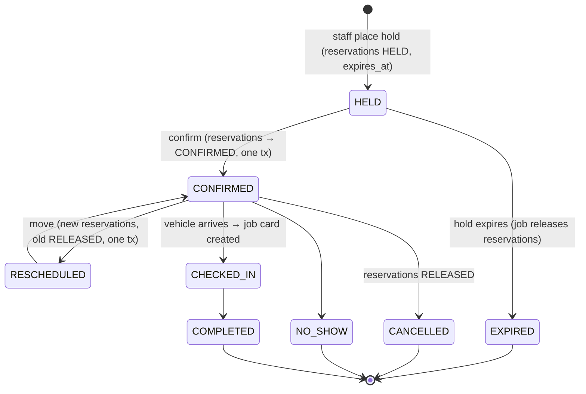

# Smart scheduling — data model and concurrency design

- **Status:** Design only (Phase 1A). Tables are created in **Phase 1E**. The scheduling engine is
  not implemented yet.
- **Rules covered:** BR-06, BR-07, BR-08, BR-09, BR-10. Decision record: ADR 0010.

## 1. Concepts

| Concept         | Meaning                                                                                                       |
| --------------- | ------------------------------------------------------------------------------------------------------------- |
| **Resource**    | Anything that can only do one job at a time: a technician, a bay/lift, a paint booth (`scheduling_resources`) |
| **Calendar**    | When a resource could work: garage working hours ∩ resource shifts − closures − leave                         |
| **Requirement** | What a service needs: duration, skill(s), number of technicians, bay capability (`service_requirements`)      |
| **Slot**        | A candidate start time where every requirement can be met by free, qualified resources. Computed, not stored  |
| **Hold**        | A short-lived claim (default 10 min) on resources while staff confirm with the customer (`capacity_holds`)    |
| **Reservation** | A time range on one resource (`resource_reservations`), status `HELD` or `CONFIRMED` while active             |
| **Appointment** | The confirmed commitment to a customer and vehicle (`appointments`), owning its reservations                  |

A booking request never touches capacity (BR-07). Capacity is consumed only when staff place a hold
or confirm an appointment.

## 2. Resource calendars

```
available(resource, day) =
      garage_working_hours(weekday, effective on day)            -- local time → tstzrange via garage_profile.timezone
    ∩ technician_shifts(resource, weekday, effective on day)     -- technicians only
    − garage_closures overlapping day
    − technician_leave overlapping day                           -- technicians only
    − resource_reservations(resource) where status in (HELD, CONFIRMED)
```

- Recurring patterns (`garage_working_hours`, `technician_shifts`) store `iso_weekday`, local
  `time` start/end and an `effective daterange`, so a schedule change is a new row from a date, not
  an edit of history.
- Exceptions (`garage_closures`, `technician_leave`) are `tstzrange` instants. Daylight saving is a
  non-issue for most target regions, but converting through the IANA zone keeps it correct anyway.
- Bays have no shifts; they follow garage hours and can be marked inactive or blocked by a
  reservation of kind `BLOCK` (maintenance).

## 3. Qualifications and compatibility

- `technician_skills (technician_id, skill_id, level, certified_until)`. A requirement with a skill
  needs `level ≥ required_level` and `certified_until IS NULL OR certified_until ≥ appointment date`.
- `bay_capabilities (service_bay_id, capability)`. A requirement with `bay_capability` needs a bay
  that has it.
- `service_requirements` lists one or more rows per `service_definition`. An appointment's demand
  is the union of its services' requirements. Durations add up per resource, and parallel work is a
  later refinement.

## 4. Duration estimates

`service_definitions.default_duration_minutes` is the catalogue default.
`service_requirements.duration_minutes` is the per-resource occupancy. `appointment_services.planned_minutes`
records what was planned for this appointment. `work_logs` (workshop phase) record actuals, which
feed future estimate tuning. A buffer per resource kind (e.g. 15 min bay turnaround) is a
`system_settings` value.

## 5. Appointment lifecycle



Booking requests have their own lifecycle (`SUBMITTED → UNDER_REVIEW → CONFIRMED | DECLINED |
WITHDRAWN`); `CONFIRMED` means "an appointment exists".

## 6. Concurrency strategy (BR-09)

### 6.1 Requirement

Two staff members (or a staff member and a future self-service flow) may try to book the same
technician or bay for overlapping times at the same moment. Exactly one must succeed. The
guarantee must hold even if application code has a bug, and it must work through Neon's PgBouncer
pooler (transaction mode).

### 6.2 Options evaluated

| Option                                                           | Correct under concurrency?                            | Works with pooler?                                         | Notes                                                                                                        |
| ---------------------------------------------------------------- | ----------------------------------------------------- | ---------------------------------------------------------- | ------------------------------------------------------------------------------------------------------------ |
| App-level check-then-insert                                      | **No**: race between SELECT and INSERT                | yes                                                        | Rejected                                                                                                     |
| `SELECT … FOR UPDATE` on the resource row, then check and insert | Yes, if every writer follows the protocol             | yes                                                        | Serialises all bookings per resource; easy to bypass by mistake                                              |
| `pg_advisory_xact_lock(resource)`                                | Yes, if every writer follows the protocol             | yes (xact-level only; session locks break with the pooler) | Same weakness: convention, not constraint                                                                    |
| `SERIALIZABLE` isolation                                         | Yes                                                   | yes                                                        | Retries on `40001` everywhere; harder to reason about; still no declarative guarantee                        |
| Discrete slot table with `UNIQUE (resource_id, slot_start)`      | Yes                                                   | yes                                                        | Forces fixed granularity; multi-slot jobs need many rows; painful for multi-day paint work                   |
| **GiST exclusion constraint on `tstzrange`**                     | **Yes, declaratively**: the database refuses overlaps | yes                                                        | Needs `btree_gist`; any granularity; one row per resource per appointment; error code `23P01` is unambiguous |

**Decision (ADR 0010):** exclusion constraint, plus a transaction-scoped advisory lock only as an
optional optimisation to reduce wasted work under heavy contention.

### 6.3 Schema sketch (Phase 1E — not created yet)

```sql
CREATE EXTENSION IF NOT EXISTS btree_gist;

CREATE TABLE resource_reservations (
  id               uuid PRIMARY KEY DEFAULT uuidv7(),
  resource_id      uuid NOT NULL REFERENCES scheduling_resources(id) ON DELETE RESTRICT,
  appointment_id   uuid REFERENCES appointments(id) ON DELETE CASCADE,
  capacity_hold_id uuid REFERENCES capacity_holds(id) ON DELETE CASCADE,
  kind             reservation_kind NOT NULL DEFAULT 'APPOINTMENT',   -- APPOINTMENT | BLOCK | PRODUCTION (later)
  status           reservation_status NOT NULL,                       -- HELD | CONFIRMED | RELEASED | CANCELLED
  during           tstzrange NOT NULL,
  created_at       timestamptz(3) NOT NULL DEFAULT now(),
  CONSTRAINT resource_reservations_during_valid
    CHECK (NOT isempty(during) AND lower_inc(during) AND NOT upper_inc(during)
           AND upper(during) - lower(during) <= interval '14 days'),
  CONSTRAINT resource_reservations_owner
    CHECK (status NOT IN ('HELD', 'CONFIRMED')
           OR kind = 'BLOCK'
           OR num_nonnulls(appointment_id, capacity_hold_id) >= 1),
  CONSTRAINT resource_reservations_no_overlap
    EXCLUDE USING gist (resource_id WITH =, during WITH &&)
    WHERE (status IN ('HELD', 'CONFIRMED'))
);
CREATE INDEX resource_reservations_appointment_idx ON resource_reservations (appointment_id);
CREATE INDEX resource_reservations_hold_idx ON resource_reservations (capacity_hold_id);
```

Half-open ranges `[start, end)` let back-to-back reservations (10:00–11:00 and 11:00–12:00) coexist.
The partial `WHERE` means released and cancelled rows stay as history without blocking capacity.

### 6.4 How double booking is avoided under concurrent requests

1. The slot search (read-only) proposes resources and times. It may be stale; that is fine.
2. **Confirm** runs one transaction: insert the appointment, insert one reservation per required
   resource (`CONFIRMED`), update the booking request and its history, enqueue the notification,
   write the audit row.
3. If another transaction committed an overlapping reservation on any of those resources first,
   PostgreSQL raises `23P01 exclusion_violation` on insert (or blocks until the other commits, then
   raises). The whole transaction rolls back, so there are no partial allocations.
4. The service maps `23P01` to a `CONFLICT` `AppError` ("That time was just taken"), re-runs the slot
   search and offers alternatives.
5. **Holds** use the same table and constraint (`HELD`), so a held slot is protected exactly like a
   confirmed one. A background job (`background_job_runs`, idempotent per minute) sets expired
   holds' reservations to `RELEASED`. Confirmation of a hold flips its reservations to `CONFIRMED`
   in place, so there is no window where the slot is free.
6. Optimistic `appointments.version` guards concurrent edits to the same appointment (reschedule vs
   cancel).

### 6.5 Verification plan (Phase 1E)

- Integration test: two parallel transactions reserve overlapping ranges on one resource → exactly
  one commits and the other gets `23P01`.
- Back-to-back `[10:00, 11:00)` and `[11:00, 12:00)` both succeed.
- `RELEASED` and `CANCELLED` rows do not block.
- Multi-resource confirm (technician + bay) where only the bay conflicts → nothing is persisted.
- Load test: 50 concurrent confirmations for 10 overlapping slots → no overlaps in the result
  (`SELECT … WHERE a.during && b.during` returns zero rows).

## 7. Bodywork inspection versus paint production (BR-10)

| Aspect      | Bodywork inspection / estimate               | Paint production                                                            |
| ----------- | -------------------------------------------- | --------------------------------------------------------------------------- |
| Booked from | Booking request → appointment                | Job card after quotation approval                                           |
| Duration    | 30–60 min                                    | Hours to days, in stages (prep, primer, paint, cure, polish; Q-09)          |
| Resources   | Advisor/technician + inspection bay          | `PAINT_BOOTH` resource (exclusive per stage) + painter skill                |
| Lifecycle   | `appointments`                               | `paint_production_blocks` (job card, stage, planned/actual times, status)   |
| Capacity    | `resource_reservations` (kind `APPOINTMENT`) | `resource_reservations` (kind `PRODUCTION`, FK `paint_production_block_id`) |
| Constraint  | `resource_reservations_no_overlap`           | The **same** `resource_reservations_no_overlap`                             |

Exclusion constraints cannot span tables, so **every** claim on a resource, whether appointment,
hold, maintenance block or paint stage, is a `resource_reservations` row. The paint lifecycle
(stages, re-sequencing, curing) lives in `paint_production_blocks`, and each block owns exactly one
reservation on its booth. A short job can therefore never be booked into a booth that a paint stage
occupies, while a multi-day paint job is never modelled as a giant "appointment". The owner CHECK
in §6.3 becomes `num_nonnulls(appointment_id, capacity_hold_id, paint_production_block_id) >= 1`
when the workshop phase adds that column.
